  

# 🧠 Awesome AI Agent Memory & Context Persistence ⚡

### *The definitive curated registry of stateful agent runtimes, long-term memory kernels, episodic & semantic recall engines, temporal knowledge graphs, and coding assistant context persistence.*

---

## 📌 Executive Summary & Architecture Overview

Modern autonomous AI agents (such as software engineering copilots, research swarms, desktop assistants, and enterprise agent workflows) suffer from severe context window degradations, forgetting, and loss of state between restarts. **AI Agent Memory & Context Persistence** represents the vital infrastructure layer solving this challenge. 

This repository systematically benchmarks and curates:
- 🧠 **Hierarchical Core & Archival Memory Systems**: Self-editing persistent memory tiers (inspired by OS paging and MemGPT).
- 🕸️ **Temporal & Dynamic Knowledge Graphs**: Bi-temporal entity tracking, relationship extraction, and continuous episodic knowledge evolution.
- 💻 **Coding Agent Session Stores**: Model Context Protocol (`MCP`) servers and local-first memory engines engineered specifically for tools like `Claude Code`, `Cursor`, and `Windsurf`.
- ⚡ **Semantic Caching & In-Memory Checkpointing**: High-throughput KV stores and vector indexes delivering sub-millisecond session state and prompt compaction.
- 🗄️ **AI-Native Vector & Multimodal Stores**: Enterprise-grade vector databases acting as long-term semantic embeddings retrieval backends.

---

## 📑 Table of Contents

- [📊 Sector Overview & Market Dynamics](#-sector-overview--market-dynamics)
- [☁️ SaaS / Hosted Platforms](#️-saas--hosted-platforms)
- [🛠️ Open-Source GitHub Projects](#️-open-source-github-projects)
- [📈 Star History](#-star-history)
- [🤝 How to Contribute](#-how-to-contribute)
- [💖 Support & Sponsorship](#-support--sponsorship)
- [📄 Disclaimer](#-disclaimer)

---

## 📊 Sector Overview & Market Dynamics

The **AI Agent Memory & Orchestration Systems** sector is projected to expand from **~$7.8B in 2025** to over **~$11.5B in 2026**, with the underlying AI vector and graph memory infrastructure expanding at a compound annual growth rate (CAGR) exceeding **24%**.

> [!NOTE]
> **Market Fragmentation vs. Concentration**: The market is currently **moderately-to-highly fragmented** at the upper application memory layer (with specialized startups competing on temporal graphs, self-editing cognitive loops, and MCP tools), while remaining **moderately concentrated** at the base vector and operational data persistence tier, where foundational infrastructure incumbents (such as Redis, Pinecone, and Qdrant) capture the bulk of high-throughput production workloads.

---

## ☁️ SaaS / Hosted Platforms

Below is the comparative breakdown of leading managed SaaS platforms and hosted cloud memory solutions for autonomous AI agents. Sorted by company scale (valuation / funding / revenue descending).

| Product | Company Scale (Valuation / Revenue) 🏢 | Pricing (Starting Tier) 💵 | Free Tier Limits 🎁 | Primary Specialization & Core Capabilities 🎯 |
| :--- | :--- | :--- | :--- | :--- |
| **[Redis Cloud & Redis LangCache](https://redis.io)** | **$2B+ Valuation** (~$300M+ ARR) | Starts at **$5/mo** (Essentials 250 MB plan; $20/mo for 1 GB) | **30 MB persistent dataset memory**, 1 database, max ~100 ops/sec, ~30 concurrent connections, and 5 GB monthly bandwidth. | In-memory operational data store and semantic caching service engineered for sub-millisecond agent state, session checkpoints, and LLM response caching. |
| **[Pinecone](https://pinecone.io)** | **$1B+ Valuation** (Series B/C Unicorn) | Starts at **$20/mo** flat (Builder Tier; $50/mo minimum for Standard Pay-As-You-Go) | **2 GB storage**, ~100k–300k vectors, 1M read units/mo, 2M write units/mo, and up to 5 indexes. | Fully managed serverless vector database widely deployed as high-throughput, horizontally scalable semantic long-term memory for enterprise agents. |
| **[Qdrant Cloud](https://qdrant.tech)** | **$250M–$500M Est. Valuation** ($88M raised, ~$10M–$15M+ ARR) | Starts at **$25/mo** (Standard Dedicated Resource Tier, hourly billed) | **1 cluster with 1 GB RAM**, 0.5 vCPU, **4 GB disk storage**, up to ~1M vectors (768-dim), and free embedding inference. | High-performance Rust-based vector search engine and semantic memory cloud offering payload-based metadata filtering and hybrid search. |
| **[Weaviate Cloud](https://weaviate.io)** | **$200M+ Valuation** (Series B, $67M+ raised) | Starts at **$45/mo** (Flex Pay-As-You-Go Plan) | **100,000 objects**, 1 GB RAM, 10 GB disk, 1 collection (3 tenants), 2,000 embedding reqs/day, and 1,000 Query Agent reqs/mo. | AI-native vector database offering hybrid BM25 + dense vector search, generative agent feedback loops, and multi-tenant persistence. |
| **[LangMem / LangGraph Cloud (LangChain)](https://langchain.com)** | **$200M Valuation** (Series A, $35M raised) | Starts at **$39/user/mo** (LangSmith Plus Plan; pay-as-you-go overages) | **5,000 base traces/mo**, 1 seat limit, 14-day trace retention, and basic community agent evaluation tooling. | Managed persistence layer and long-term semantic, episodic, and procedural memory infrastructure integrated natively with LangGraph state checkpoints. |
| **[Letta Platform (Letta Cloud)](https://letta.com)** | **$70M Valuation** ($10M Seed funded) | Starts at **$20/mo** (Pro Plan with $20 monthly usage credits) | **3 stateful agents** (BYO LLM API key), unlimited chat sessions, and core hierarchical memory management. | Managed stateful agent runtime built around MemGPT principles for self-editing hierarchical memory, perpetual learning, and daemon execution. |
| **[Mem0 Platform](https://mem0.ai)** | **$24.5M Raised** (Series A funded, ~$1M+ ARR) | Starts at **Usage-Based (Developer tier with custom spend caps)** (Past Starter was $19/mo; Custom enterprise pricing) | **50,000 memory additions & 10,000 retrievals/mo** (with BYO LLM key; 10,000 adds & 1,000 retrievals for first 30 days without key). | Cloud memory layer for personalized AI agents providing automated fact extraction, multi-level user/session scoping, and sub-second recall. |
| **[Zep Cloud](https://getzep.com)** | **$2.3M Raised** (Y Combinator backed, ~$1M ARR) | Starts at **$125/mo** (Flex Plan including 50,000 credits/mo; $375/mo for Flex Plus) | **10,000 credits/mo**, 10 custom entity types, 600 req/min, and prototyping context graph access. | Enterprise agent memory and context engineering platform powered by temporal knowledge graphs continuously synthesizing user dialogue. |
| **[Ragie](https://ragie.ai)** | **$5.5M Seed Raised** (Craft Ventures backed) | Starts at **$100/mo** (Starter Tier with unlimited retrievals) | **1,000 page document ingestion** and **1,000 retrievals total** with automated parsing, chunking, and hybrid search. | Managed RAG-as-a-Service and retrieval engine offering automated document extraction, entity indexing, and semantic context APIs for AI agents. |
| **[Graphlit](https://graphlit.com)** | **$3.56M Raised** (Unstruk Data) | Starts at **$49/mo** (Hobby Plan; $199/mo for Starter Plan) | **100 credits/mo**, 1 GB content storage, unlimited conversations, and multimodal data ingestion. | Multimodal knowledge-graph and RAG memory platform for indexing, chunking, and querying conversational histories and documents for agents. |

---

## 🛠️ Open-Source GitHub Projects

Curated open-source projects providing persistent memory, temporal knowledge graphs, session cache backends, and MCP memory servers for AI agents and coding assistants. 

> *Each repository includes a live social Stars_Badge linking directly to that project's GitHub stargazers page. Sorted by Stars_Counts in descending order.*

| Repository | GitHub_Stars 🌟 | License ⚖️ | Category & Key Agent Memory Capabilities 💡 |
| :--- | :--- | :--- | :--- |
| **[thedotmack/claude-mem](https://github.com/thedotmack/claude-mem)** |  | `MIT` | **Coding Agent Memory**: Open-source persistent memory MCP plugin for Claude Code that captures tool-use observations, compresses them into semantic summaries, and injects context across sessions. |
| **[modelcontextprotocol/servers](https://github.com/modelcontextprotocol/servers)** |  | `MIT` | **MCP Memory Engine**: Official Model Context Protocol memory server implementation enabling coding agents to persist entities, relations, and observations locally as a knowledge graph. |
| **[redis/redis](https://github.com/redis/redis)** |  | `RSALv2/SSPLv1` | **Session Cache & KV**: Ultra-low-latency in-memory data store widely deployed for conversation buffers, session state snapshots, semantic caching, and real-time state persistence. |
| **[mem0ai/mem0](https://github.com/mem0ai/mem0)** |  | `Apache-2.0` | **Universal Memory Layer**: Comprehensive memory framework combining vector, graph, and key-value stores to dynamically extract, update, and recall user, session, and agent memories. |
| **[milvus-io/milvus](https://github.com/milvus-io/milvus)** |  | `Apache-2.0` | **Distributed Vector DB**: Highly scalable open-source vector database engineered for billion-scale semantic similarity search, multi-tenant memory, and enterprise AI workloads. |
| **[khoj-ai/khoj](https://github.com/khoj-ai/khoj)** |  | `AGPL-3.0` | **Personal AI Second-Brain**: Self-hostable AI agent workspace providing continuous background indexing of Markdown, PDFs, Notion, and GitHub repositories for persistent personal context. |
| **[qdrant/qdrant](https://github.com/qdrant/qdrant)** |  | `Apache-2.0` | **Vector Search Engine**: High-performance Rust vector database with extended payload filtering, quantization, and hybrid search powering stateful agent context layers. |
| **[topoteretes/cognee](https://github.com/topoteretes/cognee)** |  | `Apache-2.0` | **Knowledge Engine & Memory Pipelines**: Deterministic AI memory framework transforming raw documents and dialogue into interconnected vector-and-graph knowledge networks for agents. |
| **[getzep/graphiti](https://github.com/getzep/graphiti)** |  | `Apache-2.0` | **Temporal Knowledge Graphs**: Dynamic knowledge-graph memory framework engineered for bi-temporal entity tracking, real-time incremental edge evolution, and hybrid graph/vector recall. |
| **[supermemoryai/supermemory](https://github.com/supermemoryai/supermemory)** |  | `MIT` | **Memory Engine for AI**: Scalable second-brain and context engine with full local execution support, browser bookmarks indexing, and universal developer Memory APIs. |
| **[chroma-core/chroma](https://github.com/chroma-core/chroma)** |  | `Apache-2.0` | **Embedded Vector Database**: Developer-first open-source embedding database tailored for quick local prototyping, agent session storage, and Python/JS native integrations. |
| **[valkey-io/valkey](https://github.com/valkey-io/valkey)** |  | `BSD-3-Clause` | **Open-Source In-Memory Store**: Community-driven open-source fork of Redis supporting fast in-memory key-value caching, conversation session state, and message broker persistence. |
| **[letta-ai/letta](https://github.com/letta-ai/letta)** |  | `Apache-2.0` | **Stateful Agent Framework**: Formerly MemGPT; equips LLM agents with self-editing core/archival memory, paging algorithms, and persistent daemon server execution. |
| **[pgvector/pgvector](https://github.com/pgvector/pgvector)** |  | `PostgreSQL` | **Relational + Vector Persistence**: Open-source vector similarity extension for PostgreSQL, powering ACID-compliant agent state checkpointing (e.g., `LangGraph PostgresSaver`). |
| **[GibsonAI/Memori](https://github.com/GibsonAI/Memori)** |  | `Apache-2.0` | **SQL-Native Agent Memory**: Open-source memory engine allowing LLMs and agent frameworks to record, query, and persist structured episodic and semantic memories directly in SQL databases. |
| **[neo4j/neo4j](https://github.com/neo4j/neo4j)** |  | `GPL-3.0` | **Property Graph Database**: Leading graph database engine powering GraphRAG, entity-relationship mapping, and multi-hop cognitive memory architectures for complex agent reasoning. |
| **[weaviate/weaviate](https://github.com/weaviate/weaviate)** |  | `BSD-3-Clause` | **Cloud-Native Vector DB**: AI vector search engine featuring hybrid keyword + vector retrieval, multi-tenancy, and pluggable vectorizers for long-term agent context storage. |
| **[MemTensor/MemOS](https://github.com/MemTensor/MemOS)** |  | `Apache-2.0` | **Memory Operating System**: Unified scheduling, lifecycle management, and cross-session persistence across parametric, activation, and plaintext memory for LLMs and agents. |
| **[lancedb/lancedb](https://github.com/lancedb/lancedb)** |  | `Apache-2.0` | **Serverless Vector DB**: Embedded vector database built on the Lance columnar data format for lightning-fast disk-based vector search and low-memory agent persistence. |
| **[FalkorDB/FalkorDB](https://github.com/FalkorDB/FalkorDB)** |  | `Server Side Public` | **Low-Latency Graph DB**: Redis-based low-latency property graph database optimized for real-time GraphRAG, dynamic knowledge graphs, and relational agent recall. |
| **[asg017/sqlite-vec](https://github.com/asg017/sqlite-vec)** |  | `Apache-2.0` | **Embedded SQLite Vectors**: Extremely lightweight, zero-dependency SQLite extension for vector search, ideal for local-first desktop agents and single-file persistent session state. |
| **[zilliztech/GPTCache](https://github.com/zilliztech/GPTCache)** |  | `MIT` | **Semantic Caching**: Semantic caching layer for LLMs and agents that stores and retrieves semantically similar queries to drastically cut down API latency and inference costs. |
| **[campfirein/cipher](https://github.com/campfirein/cipher)** |  | `Apache-2.0` | **Cross-IDE Agent Memory**: Shared persistent memory and contextual indexing layer designed for coding assistants across Claude Code, Cursor, Windsurf, and VS Code. |
| **[basicmachines-co/basic-memory](https://github.com/basicmachines-co/basic-memory)** |  | `AGPL-3.0` | **Markdown & SQLite MCP**: Local-first MCP server storing agent dialogue and knowledge in human-readable Markdown files synced with an embedded SQLite semantic graph. |
| **[kingjulio8238/memary](https://github.com/kingjulio8238/memary)** |  | `Apache-2.0` | **Agentic Memory Graphs**: Context persistence library combining Neo4j knowledge graphs, Chroma vector search, and recursive summarization for multi-agent systems. |
| **[langchain-ai/langmem](https://github.com/langchain-ai/langmem)** |  | `MIT` | **Cognitive Memory SDK**: LangChain's memory toolkit enabling agents to extract semantic facts, episodic encounters, and procedural instructions into persistent stores. |
| **[agiresearch/A-mem](https://github.com/agiresearch/A-mem)** |  | `MIT` | **Self-Evolving Memory**: Agentic memory framework implementing Zettelkasten-inspired note-linking and dynamic self-updating memory webs for autonomous LLMs. |
| **[getmetal/motorhead](https://github.com/getmetal/motorhead)** |  | `Apache-2.0` | **Context Compactor**: Lightweight Rust memory server handling automated background conversation summarization and incremental context compression for chat agents. |

---

## 📈 Star History

---

## 🤝 How to Contribute

Contributions are warmly welcome! Help keep this ecosystem comprehensive, accurate, and up-to-date:

1. 🍴 **Fork the repository** to your own GitHub profile.
2. 🌿 **Create a descriptive feature branch** (`git checkout -b add-my-memory-tool`).
3. 📝 **Add or edit entries in `README.md`**:
   - For **SaaS Products**: Ensure all columns are filled (`Product`, `Company Scale`, `Pricing starting tier`, `Free Tier Limits`, and `Specialization`). Include specific pricing numbers rather than generic descriptions.
   - For **Open-Source Projects**: Include the repository link, live Stars_Badge (`https://img.shields.io/github/stars/...`), license badge, and a 1–2 sentence description of memory architecture. Keep the list sorted by Stars_Count.
4. 🔍 **Verify markdown formatting** and ensure all links are valid.
5. 🚀 **Commit and push** your changes, then open a Pull Request.

---

## 💖 Support & Sponsorship

If this curated registry helps you architect stateful AI agents, reduce token context costs, or discover breakthrough memory engines, please consider supporting the project:

- ⭐ **Star this repository** to help other developers discover it!
- 🍴 **Fork and share** with your AI engineering teams and community.
- ☕ **Sponsor the maintainer**: Buy a coffee or support ongoing open-source curation on the [GitHub Sponsors Dashboard](https://github.com/sponsors/ishandutta2007).

---

## 📄 Disclaimer

*This list is curated for educational and architectural reference purposes. Product names, logos, and trademarks belong to their respective companies and open-source project maintainers. Pricing tiers, free limits, and valuation metrics reflect public benchmark data as of November 2026 and may be updated periodically by respective vendors.*
